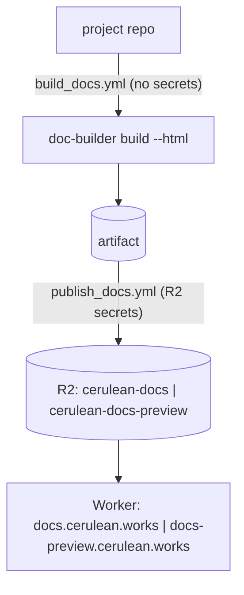

# Architecture and contracts

doc-builder turns a project's Markdown docs and Python docstrings into a static documentation site. Every (project, version) pair is built on its own, stored in Cloudflare R2, and served by a Cloudflare Worker.

This page is the specification the three parts of doc-builder are built and tested against. If you change one side of a contract, change the other side and the fixtures in the same pull request.



The repo has three parts, and the contracts below define how they fit together:

| Directory | What it does |
|---|---|
| `src/doc_builder/` | Python CLI: converts Markdown and docstrings to MDX, then stages them into the kit |
| `kit/` | SvelteKit app: renders every page as a complete HTML document, plus the Pagefind search index |
| `worker/` + `.github/workflows/` | Serving, routing, version manifests, and the CI that builds and publishes |

[`docs/fixtures/`](https://github.com/cerulean-works/doc-builder/tree/main/docs/fixtures) holds a small golden example of each handoff:
- `source/`: an input docs folder in the C4 toctree format
- `handoff/`: what Python stages into the kit for it (C5)
- `r2-keys.txt`: the objects that end up in R2 for it (C2/C3)

## C1. URLs

- **Domains.** Prod is `docs.cerulean.works` and PR previews are `docs-preview.cerulean.works`. Both are placeholders in the wrangler config. Previews use a separate origin because PR builds run untrusted JavaScript.
- **Page URLs** have the form `/<project>/<version>/<section>/<page>/`.
  - `section` is `guide` or `reference`.
  - URLs always end in `/` and never contain `.html`.
  - A section's index page is `/<p>/<v>/<section>/`.
- **Markdown export.** For a page at `X/`, the Markdown export is at `X.md`. For example, `/<p>/<v>/guide/quickstart/` maps to `/<p>/<v>/guide/quickstart.md`, and `/<p>/<v>/guide/` maps to `/<p>/<v>/guide.md`.
- **Versions.** A version is `main`, a git tag such as `v1.2.0`, or `pr_<N>` (previews only).
- **Redirects.** The Worker serves all of these as 302:
  - `/<p>` and `/<p>/` go to `/<p>/<default>/guide/`.
  - `/<p>/<v>/` goes to `/<p>/<v>/guide/`.
  - `/<p>/<section>/<rest>`, a path with no version, goes to `/<p>/<default>/<section>/<rest>`.
  - `/<p>/latest/<rest>` goes to `/<p>/<default>/<rest>`. This must always redirect, never serve in place, because client-side routing only works within the build's base path.
- **Default version.** The default is the highest semver tag that isn't a prerelease, or `main` if there are no tags.
- **`/`** is a landing page that lists the projects. The Worker renders it.

## C2. R2 layout

There are two buckets: `cerulean-docs` (prod) and `cerulean-docs-preview` (previews). Objects are laid out like this:

```
<p>/<v>/...            build output (C3)
<p>/_versions/<v>      empty marker object, customMetadata {commit, built_at}; written LAST by publish
<p>/_project.json      {name, title, description, repo}; prod only, copied from the build by trusted publish
```

The Worker derives its manifests rather than reading stored ones, so concurrent builds never race on a shared file:
- `GET /<p>/_versions.json` returns `{default, versions: [{version, commit, built_at}]}`, sorted with `main` first and then tags in descending semver order. It is built from one paginated `list({prefix: "<p>/_versions/", include: ["customMetadata"]})`.
- `GET /_projects.json` returns `[{name, title, description, repo, default}]`. It is built from the top-level prefixes plus each project's `_project.json`.
- Both manifests are cached for 60 seconds or less.

## C3. Build output

`doc-builder build <p> <docs_dir> --version <v> --build_dir out --html` writes `out/<p>/<v>/`:

```
guide/index.html, guide/**/index.html            full HTML documents
reference/index.html, reference/**/index.html
guide.md, guide/**.md, reference/**.md           markdown export per page (C1)
404.html                                         SvelteKit fallback page, rendered with the site layout
llms.txt, llms-full.txt
_app/                                            SvelteKit assets (_app/immutable/** is content-hashed)
pagefind/                                        search index for this (project, version)
objects.inv                                      Python modules only
imgs/**, other assets                            copied from the docs folder
_project.json                                    {name, title, description, repo}
```

Python does not write any version marker. Publish writes the `_versions/<v>` marker after everything else has been uploaded.

## C4. Toctree and config

A docs folder has one `_toctree.yml`:

```yaml
guide:
  - title: Get started
    sections:
      - local: index
        title: Introduction
reference:
  - title: API
    sections:
      - local: api/utils
        title: Utilities
```

Entries use the existing format: `{title, local?, sections?, isExpanded?}`.
- `local` is a path relative to the docs folder, with no extension.
- Every page appears in exactly one section.
- `newlocal`, `local_fw` and `quiz` are no longer supported.

A page's URL is `/<p>/<v>/<section>/<local>/`, except that a `local` of `index` (or one ending in `/index`) maps to its directory. If both `foo` and `foo/index` exist, the build fails.

Cross-references such as `` [`Foo`] `` resolve through the autodoc anchor map to `/<p>/<v>/<section>/<local>/#<anchor>`.

`_config.py` in the docs folder may set:
- `project_title`
- `project_description`
- `repo` (`owner/name`)
- `default_branch_name`
- `disable_toc_check`

## C5. Python → kit handoff

Python copies `kit/` into a temporary directory, never into the repo, and stages the build into that copy:

| Source | Staged as |
|---|---|
| page `<local>` in section `s` | `src/routes/<s>/<local>/+page.svelte` and `+page.ts` |
| page `index` in section `s` | `src/routes/<s>/+page.svelte` and `+page.ts` |
| a section with no `index` page | `src/routes/<s>/+page.ts`, which redirects to the first entry's URL, plus an empty `+page.svelte` |
| non-page files (images, etc.) | `static/<same relative path>` |
| site metadata | `src/lib/generated/site.json` |

**Each `+page.svelte`:**
- It starts with a `<script lang="ts">` block that imports exactly these components from `$lib`: `Tip`, `Added`, `Changed`, `Deprecated`, `CodeBlock`, `ExampleCodeBlock`, `Docstring`, `Heading`, `MermaidChart`, `Youtube`, `Tabs`, `Tab`. The kit must provide every one of them.
- The body sits between `HF_DOC_BODY_START` and `HF_DOC_BODY_END`. The kit's escaping of `{` and `<` depends on those markers.
- It has no `<svelte:head>` metadata, no `CopyLLMTxtMenu` and no `EditOnGithub`. The layout renders all of that.
- Autodoc output is wrapped in `<div class="docstring">`. The kit styles this class; Python emits no Tailwind classes on it.
- Links and images are absolute and already include the base path: `/<p>/<v>/...`.

**Each `+page.ts`** looks like this:

```ts
import { metadata } from "./+page.svelte";
export const load = () => ({ section, title, editUrl, mdUrl, headings: JSON.parse(metadata) });
```

- The kit's mdsvex step must always give every page a module export `metadata`. Its value is a JSON string holding either the H1 heading tree `{title, local, depth, sections: [...]}` or `null`.
- `title` is the toctree title.
- `editUrl` is `https://github.com/<repo>/blob/<sourceRef>/<path to source file>`.
- `mdUrl` is the C1 Markdown export URL.

**`site.json`** contains:

```json
{ "project", "title", "description", "version", "repo", "sourceRef",
  "toctree": { "guide": [entry], "reference": [entry] } }
```

Each entry keeps its nesting. Every entry with a `local` also gets its resolved `url`.

**Environment variables.** The kit build receives `DOCS_PROJECT` and `DOCS_VERSION`. The SvelteKit base path is always `/<DOCS_PROJECT>/<DOCS_VERSION>`, in dev mode too.

**`pnpm run build`** must produce the whole C3 tree except the `.md` exports, `llms*.txt`, `objects.inv` and `_project.json`, which Python writes afterwards. In particular:
- It runs `vite build` and then `pagefind --site build`.
- It uses `trailingSlash = "always"`.
- It produces the adapter-static fallback `404.html`.

## C6. CLI

```
doc-builder build <project> <docs_dir> --version <v> --build_dir <dir> [--html]
    [--not_python_module] [--mock_deps a,b] [--repo owner/name]
    [--source_ref <git sha or ref>] [--site_url https://docs.cerulean.works]
doc-builder preview <project> <docs_dir> [--not_python_module]
doc-builder style ...
doc-builder check-links ...
doc-builder convert ...
```

- `--source_ref` drives the GitHub source links (autodoc) and the edit links. It defaults to the default branch name.
- `--site_url` is the absolute origin used in `llms.txt`.
