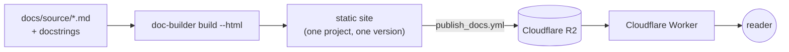

# Introduction

doc-builder turns a project's Markdown pages and Python docstrings into a documentation website. It builds and serves every [cerulean-works](https://github.com/cerulean-works) project's docs, including the page you are reading.

Each project gets one site per version, and each site has two sections:

- **Guide**: hand-written pages such as tutorials, how-tos and explanations.
- **Reference**: precise descriptions of your API, configuration and commands. For a Python package this is usually generated from its docstrings with `[[autodoc]]`.

You choose which section each page goes in, using two trees in [`_toctree.yml`](toctree).

## Where the docs live

| Deployment | Address | What it serves |
|---|---|---|
| Production | `docs.cerulean.works` | `main` and every git tag of every project |
| Preview | `docs-preview.cerulean.works` | one build per open pull request |

Pages have stable URLs: `/<project>/<version>/<guide|reference>/<page>/`. A few shortcuts are also available:
- `/<project>` opens the latest release, or `main` if the project has no tags yet.
- `/<project>/latest/...` always points at that same version.
- A link without a version, such as `/<project>/guide/quickstart/`, goes to the same page in the latest release.

## How it works

1. **Build.** `doc-builder build` converts every page to MDX and renders it with a SvelteKit app. The result is a complete static site with search included: an index built by [Pagefind](https://pagefind.app) ships with the site.
2. **Publish.** A GitHub workflow uploads that folder to R2 under `<project>/<version>/`. A version only appears on the site once its upload has finished.
3. **Serve.** A Cloudflare Worker maps URLs to files in R2. It also handles the redirects, and lists the projects and versions shown in the switchers at the top of every page.

Every version is built and stored on its own, so publishing a new release never changes the pages of an older one. [How production works](production) follows a release through all three steps.

## Next steps

- [Quickstart](quickstart): add docs to a project and preview them locally.
- [Writing pages](writing): the Markdown you can use, from callouts to tabs and diagrams.
- [Documenting a Python API](api-docs): generate reference pages from docstrings.
- [Publishing a project](publishing): the four GitHub workflows that build, publish and preview your docs.
- [How production works](production): how projects and versions are identified, and what R2 stores.
