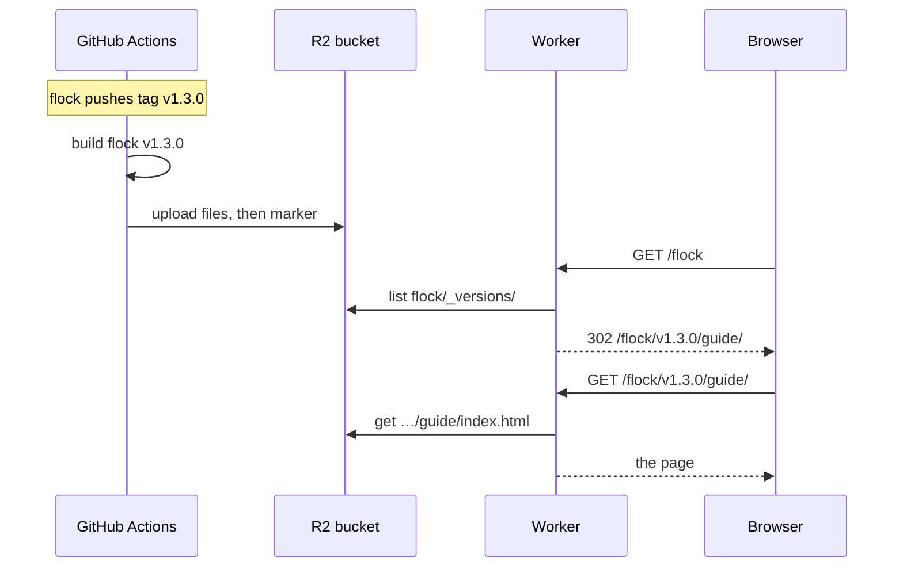

# How production works

The production docs have no database and no list of projects or versions stored anywhere. There are three moving parts:
- **CI** builds each (project, version) into a folder of static files.
- **R2** stores those folders. The names of the objects in the bucket are the only record of what exists.
- **The Worker** answers every request by reading R2: it serves files, and it works out the project and version lists by listing the bucket.

This page follows a release through all three, then explains how projects and versions are identified and what the bucket holds. For the exact formats, see [Architecture and contracts](architecture).



## The life of a release

Say the `flock` repository pushes the tag `v1.3.0`, with the workflows from [Publishing a project](publishing).

1. **The tag triggers `docs.yml`.** Its `on:` block lists `main` and tags matching `v*`, so nothing else in the repository ever reaches production.
2. **`build_docs.yml` names the version and builds it.**
   - The version comes from the git ref: a tag push builds the version named exactly like the tag, `v1.3.0`.
   - It checks out doc-builder at the ref the workflow pinned in `uses:`, and `flock` at the commit that was pushed.
   - It runs `doc-builder build flock … --version v1.3.0 --html` and uploads the folder `flock/v1.3.0/` as an artifact. This job has no secrets.
3. **`publish_docs.yml` copies the folder into the `cerulean-docs` bucket** under `flock/v1.3.0/`. The last thing it writes is an empty object, `flock/_versions/v1.3.0`. Until that object exists, the version isn't listed anywhere (see [How a publish stays consistent](#publish-order)).
4. **Within a minute or two, readers see it.**
   - The version menu in the header lists `v1.3.0`.
   - If `v1.3.0` is now the highest stable tag, `docs.cerulean.works/flock` opens it.
   - Older versions are untouched and still served at their own URLs.

Pushes to `main` work the same way, with the version `main`. A later push to `main` replaces the `main` build in place.

## How projects are identified

**The name** of a project is the `project:` input in its workflow files. It isn't taken from the repository name or from `_config.py`. That name becomes:
- the first segment of every URL: `docs.cerulean.works/flock/…`
- the top-level folder in the bucket: `flock/…`

A name may contain letters, digits, `_` and `-`, and must start with a letter or digit. The build and the publish workflow both reject anything else.

**A project exists** when the bucket has a top-level folder with that name and at least one version marker under `<project>/_versions/`. To list the projects, the Worker:
1. lists the top-level folders of the bucket
2. keeps those with a valid name and at least one version marker
3. reads each one's `_project.json` for its title, description and repository

There is no registry: publishing a project for the first time is what creates it, and deleting its last marker hides it.

> [!WARNING]
> Nothing ties a project name to a repository. Any workflow with the R2 secrets can publish under any name, and two repositories that use the same `project:` overwrite each other's versions. Choose names that are unique across the organization.

**Title, description and repository** come from the docs folder's [`_config.py`](config):
- The build writes them into `_project.json` (`project_title`, `project_description`, `repo`).
- Publishing copies that file to `<project>/_project.json` when it publishes `main`, or when the project has no `_project.json` yet. This way, re-running an old tag's build never brings back an old title.
- Without a `_project.json`, the project is shown under its name, with no description.

**Renaming a project** means publishing under the new name and [deleting the old one](#removing-things). Old URLs don't redirect.

## How versions are identified

**The name** of a version is decided by `build_docs.yml` from the event that started the workflow:

| Event | Version | Example |
|---|---|---|
| Tag push | the tag name, unchanged | `v1.3.0`, `1.3.0`, `v2.0.0rc1` |
| Any other push | `main`, whichever branch was pushed | `main` |
| Pull request | `pr_<number>` | `pr_42` (previews only) |
| any, with the `version` input set | that value | `next` |

A version name may contain letters, digits, `.`, `_`, `+` and `-`. `latest` is reserved for the [`latest` redirect](worker#routes). Git tags with other characters, such as `/`, fail the build.

Which branches and tags get built at all is up to each project's `on:` block. The template builds only `main` and tags starting with `v`. Adding another branch there would publish it over `main`, so give it a `version` instead.

**A version exists** when its marker object `<project>/_versions/<version>` exists. The marker is empty, and its metadata records:
- `commit`: the commit the version was built from
- `built_at`: when it was published

The version menu and `/<project>/_versions.json` list exactly the versions that have a marker. A version whose files are in the bucket but whose marker isn't, for example while it is still uploading, can still be opened by its exact URL. It is never listed, and it is never the default.

**Order and default version.** The Worker sorts versions and picks the default from their names alone:

| Kind | Example | Listed | Can be the default |
|---|---|---|---|
| `main` | `main` | first | only if there is no stable tag |
| Stable tag | `v1.10.0`, `1.2` | after `main`, highest first | yes: the highest one |
| Prerelease tag | `v2.0.0-rc.1`, `v2.0.0rc1`, `v1.4.0b2`, `v1.4.0.dev0` | among the tags, below the matching release | never |
| Other name | `next`, `release-candidate` | after the tags | never |
| Pull request | `pr_42` | last, newest first | only on the preview domain, which has no `main` |

Tags are compared as version numbers, so `v1.10.0` sorts above `v1.9.2`. A leading `v` is optional. Build metadata such as `+build.5` is ignored when comparing.

`/<project>`, `/<project>/latest/…` and links without a version (`/<project>/guide/…`) all redirect to the default version. The [Worker reference](worker#default-version) covers the redirects.

**Each version is a separate, frozen site.** A version is built once and its files are never touched again unless that version is published again. As a result:
- Each version keeps the doc-builder interface it was built with. A design change in doc-builder reaches an old tag only if that tag is rebuilt.
- Each version has its own search index, so search only covers the version you are reading.
- Switching versions in the header loads the same page under the other version. If that version doesn't have the page, you get its "page not found" page.

## What R2 stores

Production uses the bucket `cerulean-docs`. With two projects published, it looks like this:

```text
cerulean-docs/
├── flock/
│   ├── _project.json          title, description, repo
│   ├── _versions/
│   │   ├── main               empty markers that carry
│   │   ├── v1.2.0             commit and built_at
│   │   └── v1.3.0
│   ├── main/                  one static site per version
│   ├── v1.2.0/
│   └── v1.3.0/
│       ├── guide/index.html   pages, one folder each
│       ├── guide/quickstart/index.html
│       ├── guide.md, guide/quickstart.md   Markdown exports
│       ├── reference/…
│       ├── 404.html           this version's "not found"
│       ├── llms.txt, llms-full.txt
│       ├── _app/              scripts and styles
│       ├── pagefind/          search index
│       ├── objects.inv        Python projects only
│       ├── imgs/…             files from the docs folder
│       └── _project.json      copy kept with the build
└── doc-builder/
    └── …
```

| Object | Written by | Read by |
|---|---|---|
| `<p>/<v>/…` | publish, from the build | the Worker, to serve files |
| `<p>/_versions/<v>` | publish, last | the Worker, to list versions and pick the default |
| `<p>/_project.json` | publish, from `main` or a project's first version | the Worker, for the project list and the landing page |

Things that are **not** in the bucket:
- Any stored list of projects or versions. `/_projects.json` and `/<p>/_versions.json` are computed from the listings above.
- The Worker's code. Cloudflare deploys it separately from this repository (see [Deploying doc-builder](deploying#6-connect-the-repository-in-cloudflare)).
- Anything about pull requests. Previews live in their own bucket, `cerulean-docs-preview` (see [Previews](#previews)).

## How a publish stays consistent[[publish-order]]

`publish_docs.yml` uploads a build in a fixed order. At every step, readers see either the old version or the new one, never a page that refers to a missing file.

| Step | What | Why this order |
|---|---|---|
| 1 | Scripts, styles, search index, images | Pages need these, so they go first. |
| 2 | Pages (`*.html`) | Always rewritten, even when a re-run uploads an older build. |
| 3 | `<p>/_project.json` (`main` or first publish only) | |
| 4 | The marker `<p>/_versions/<v>` | Lists the version. If an earlier step fails, a new version stays hidden. |
| 5 | Delete files the new build no longer has | Last, so pages being read during the upload keep working. |

Step 5 keeps old files under `_app/immutable/`. A reader who opened a page before the publish may still load scripts from the previous build when they click a link. These old files are small and are never deleted automatically.

Two publishes never run at once for the same project and version. A second run waits for the first one, and the [caller's `concurrency` block](publishing#releases-and-main) keeps pushes in order. Publishing the same version again, by re-running its workflow, simply replaces it.

## How a request is served

The Worker turns each URL into one or two R2 operations:

| Request | What the Worker does |
|---|---|
| `GET /` | Lists the projects (as above) and renders the landing page. |
| `GET /flock` | Lists `flock/_versions/`, picks the default, and redirects to `/flock/v1.3.0/guide/`. |
| `GET /flock/v1.3.0/guide/quickstart/` | Gets `flock/v1.3.0/guide/quickstart/index.html`. |
| `GET /flock/v1.3.0/guide/missing/` | Gets nothing, so it returns `flock/v1.3.0/404.html` with status 404. |
| `GET /flock/_versions.json` | Lists `flock/_versions/` and returns it as JSON. |

Once a page has loaded, it is a static site running in the browser. The header fetches `/_projects.json` and `/flock/_versions.json` to fill the project and version menus. In `doc-builder preview` those requests fail, so each menu shows only the current item.

**When changes become visible.** Changes are cached in two places:
- The Worker remembers each listing for up to 60 seconds in every Cloudflare data center.
- Browsers may reuse a page, a redirect or a list for up to 60 seconds.

So a new version usually shows up within a minute, and always within two. Files under `_app/immutable/` are cached for a year, which is safe because their names change whenever their contents do.

## Previews

PR previews use the same build, layout and Worker code. Only these things differ:

| | Production | Preview |
|---|---|---|
| Domain | `docs.cerulean.works` | `docs-preview.cerulean.works` |
| Bucket | `cerulean-docs` | `cerulean-docs-preview` |
| Versions | `main` and tags | `pr_<N>` |
| `_project.json` | published | never published; projects show their name |
| Removal | by hand | when the PR closes, or 30 days after its last push |
| Search engines | indexed | `noindex` |
| Trust | built from pushed commits | built from PR code, checked before upload |

[How previews stay safe](publishing#how-previews-stay-safe) explains the checks.

## Removing things

Previews remove themselves. There is no workflow for removing production docs, so you do it by hand with an R2 token that can write `cerulean-docs`, using the AWS CLI as the workflows do. Set `DOC_BUILDER_R2_ACCESS_KEY_ID`, `DOC_BUILDER_R2_SECRET_ACCESS_KEY` and `CLOUDFLARE_ACCOUNT_ID` in your shell to the values of the organization secrets, then:

```bash
export AWS_ACCESS_KEY_ID="$DOC_BUILDER_R2_ACCESS_KEY_ID" AWS_SECRET_ACCESS_KEY="$DOC_BUILDER_R2_SECRET_ACCESS_KEY"
r2() { aws --endpoint-url "https://$CLOUDFLARE_ACCOUNT_ID.r2.cloudflarestorage.com" --region auto "$@"; }
```

**One version.** Delete the marker first, so the version disappears from the menus before its pages do:

```bash
r2 s3 rm s3://cerulean-docs/flock/_versions/v1.2.0
r2 s3 rm s3://cerulean-docs/flock/v1.2.0/ --recursive
```

**A whole project.** Delete every marker first, then everything else:

```bash
r2 s3 rm s3://cerulean-docs/flock/_versions/ --recursive
r2 s3 rm s3://cerulean-docs/flock/ --recursive
```

> [!WARNING]
> Deletes in R2 are permanent. List what you are about to remove first, with `r2 s3 ls s3://cerulean-docs/flock/`.

Links to removed pages return 404. A removed default version is replaced by the next one within a minute or two.
