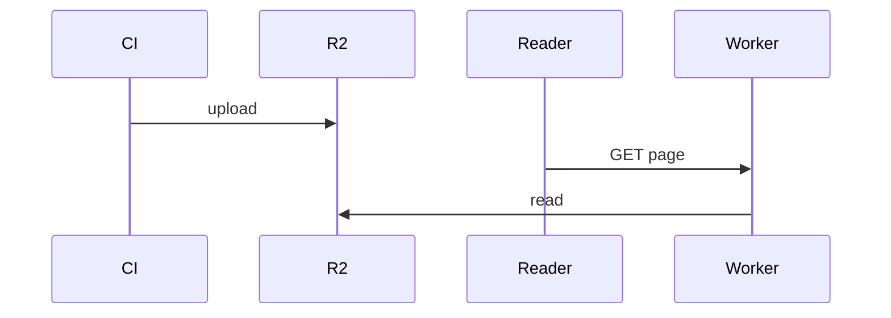

# Markdown syntax

Everything you can use in a page, beyond standard Markdown (headings, lists, emphasis, tables, links, images, code). For a gentler introduction, see [Writing pages](writing).

## Headings and anchors

| Syntax | Result |
|---|---|
| `# Title` | The page title. Use exactly one per page. |
| `## Section`, `### Subsection` | Listed in **On this page**, with anchor `section` and `subsection` |
| `## Section[[custom-id]]` | The same heading with the anchor `custom-id` |

Automatic anchors are the heading text in lowercase, with spaces replaced by `-` and other punctuation removed.

## Links

| Syntax | Links to |
|---|---|
| `[text](other-page.md)`, `[text](other-page)` | another page, by its path relative to this file |
| `[text](other-page#anchor)` | a heading on another page |
| `[text](#anchor)` | a heading on this page |
| `` [`Object`] ``, `` [`module.function`] `` | an object documented with `[[autodoc]]`, shown with its path |
| `` [`~module.function`] `` | the same, shown without its path |
| `[text](https://...)` | an external page |

Relative links are rewritten to the full URL of the same version of the docs.

## Callouts

```md
> [!NOTE]
> Useful context.
```

The types are `NOTE`, `TIP`, `IMPORTANT`, `WARNING` and `CAUTION`. Older pages may use `<Tip>...</Tip>` or `<Tip warning={true}>...</Tip>`, which render the same way.

## Code blocks

````md
```python
print("highlighted")
```
````

- **Language:** any language known to highlight.js. `bash`, `python`, `yaml`, `json`, `ts` and `diff` are the common ones.
- **Copy button:** every block gets one.
- **Wrapping:** `<!-- WRAP CODE BLOCKS -->` on its own line wraps every code block on the page instead of scrolling.
- **Runnable examples:** fences marked `py runnable` (or `python runnable:<label>`) can be run as tests. See [Testing code examples](testing-examples).

### Including code from a file

```md
<literalinclude>
{"path": "../../examples/quickstart.py",
"language": "python",
"start-after": "START quickstart",
"end-before": "END quickstart",
"dedent": 4}
</literalinclude>
```

- `path` is relative to the page. It is the only required key.
- `language` defaults to none.
- `start-after` and `end-before` are marker comments in the file.
- `dedent` is a number of spaces to remove.

`<include>` with the same JSON includes Markdown instead of code.

## Tables

Tables size to their content. To stretch every table on a page to the full content width, put `<!-- STRETCH TABLES -->` on its own line. Wide tables scroll inside their own box on small screens.

## Tabs

````md
<tabs id="os">
<tab id="macOS">

Use Homebrew.

</tab>
<tab id="Linux">

Use your package manager.

</tab>
</tabs>
````

- The `id` of each `<tab>` is its label.
- Tab groups with the same `id` on a page switch together, and the choice is kept in the URL (`?os=Linux`).
- `<hfoptions>`/`<hfoption>` are accepted as older spellings.

## Diagrams

````md

````

Any [Mermaid](https://mermaid.js.org) diagram works. It follows the light and dark theme.

## Math

| Syntax | Result |
|---|---|
| `$$E = mc^2$$` | display math |
| `\\( E = mc^2 \\)` | inline math |

Math is rendered with KaTeX when the site is built.

## Version notes

In pages and docstrings:

```md
<Added version="1.2.0">

`timeout` was added.

</Added>
```

`<Changed version="...">` and `<Deprecated version="...">` work the same way.

## Video

```md
<Youtube id="dQw4w9WgXcQ"/>
```

## Raw HTML

Standard HTML tags are allowed. Text that only looks like a tag, such as `<agent>` in a sentence, is shown as written, and so are `{braces}`.
