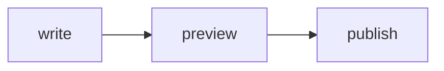

# Writing pages

Pages are Markdown files (`.md` or `.mdx`) in the docs folder. This page covers what you'll use day to day. Every construct is listed in [Markdown syntax](syntax).

> [!TIP]
> Coding agents can follow the same conventions through the [`cerulean-docs` skill](https://github.com/cerulean-works/doc-builder/blob/main/skills/cerulean-docs/SKILL.md). Copy its folder into a repository's `.claude/skills/`.

## One page, one title

Each page starts with a single `#` heading. It becomes the page title in the browser tab and in search results. The `##` and `###` headings below it fill the **On this page** list on the right.

Keep a page focused on one task or one topic. A long page with many `##` sections is easier to scan than many tiny pages.

## Guide or Reference?

Put a page in the **Guide** when readers follow it: tutorials, how-tos, explanations. Put it in the **Reference** when readers look things up: API docs, configuration keys, CLI flags. The choice is made in [`_toctree.yml`](toctree), not by the file's location, so you can move a page between sections without renaming it.

## Linking

Link to another page by its path relative to the current file, with or without the extension:

```md
See the [installation guide](install.md) or the [API](api/models).
```

doc-builder rewrites these links to the page's real URL, including the right section and version, so links never point at a different version of the docs.

To link to an object documented with `[[autodoc]]`, put its name in backticks inside brackets: `` [`Flock`] ``. See [Documenting a Python API](api-docs#cross-references).

Every heading has an anchor. It's the heading text in lowercase, with spaces turned into `-` and other punctuation removed. To choose your own anchor, append it in double brackets:

```md
## Choosing a backend[[backends]]
```

## Images

Put images next to your pages (for example in `docs/source/imgs/`) and reference them with a relative path. They are copied into the build:

```md

```

## Code

Fenced code blocks get syntax highlighting and a copy button:

````md
```python
from flock import Flock

flock = Flock(size=8)
```
````

Long lines scroll horizontally. To wrap them instead for a whole page, put `<!-- WRAP CODE BLOCKS -->` on a line of its own anywhere in the page.

## Callouts

Use GitHub-style alerts for notes and warnings:

```md
> [!TIP]
> Run `doc-builder preview` while you write.

> [!WARNING]
> This deletes the preview immediately.
```

`NOTE`, `TIP`, `IMPORTANT`, `WARNING` and `CAUTION` are supported. They render like this:

> [!NOTE]
> A note, for context that is useful but not essential.

> [!WARNING]
> A warning, for things that can go wrong.

## Tabs

Show alternatives side by side with `<tabs>`. Blocks that share an `id` on the same page switch together:

````md
<tabs id="install">
<tab id="pip">

```bash
pip install flock
```

</tab>
<tab id="uv">

```bash
uv add flock
```

</tab>
</tabs>
````

## Diagrams and math

A ` ```mermaid ` code block renders as a diagram that follows the light and dark theme:

````md

````


Math uses LaTeX: `$$ ... $$` for display math, and `\\( ... \\)` inline.

$$\text{throughput} = \frac{\text{agents} \times \text{steps}}{\text{seconds}}$$

## Copy page and Markdown exports

Every page has a **Copy page** menu next to its title. It copies the page as Markdown, ready to paste into an AI assistant. The same Markdown is published next to each page, at the page URL without the trailing slash plus `.md`. Each version also has an `llms.txt` and an `llms-full.txt` at its root.
